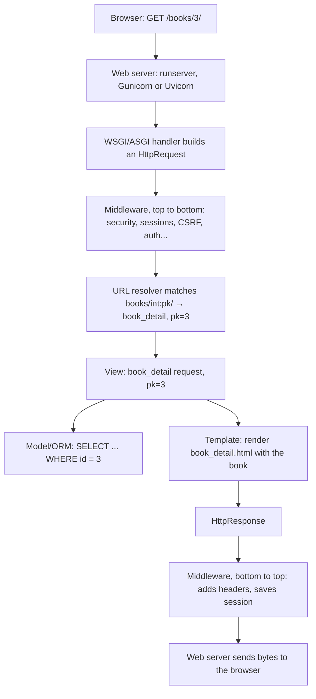

# 01 · What Django Is: The Request/Response Cycle

Django is a Python web framework that comes with the parts most server-rendered
applications end up needing: a URL router, an ORM with schema migrations, a template
language, form handling and validation, authentication, an automatic admin interface,
sessions, caching, internationalisation, and protection against the common web attacks.
The project's own description is "the web framework for perfectionists with deadlines",
and the deadlines half is the important one. You don't assemble a stack from a dozen
libraries; you get one that was designed to fit together, with a single set of docs.

This lesson explains what that means in practice, what Django is a good and a poor fit
for, and, most importantly, the path a single request takes through a Django project.
Every later lesson hangs off that path.

## The parts you get

| Part | What it does | Where you'll meet it |
|------|--------------|----------------------|
| URL dispatcher | Maps a path like `/books/3/` to a Python function | Lesson 03 |
| Views | Functions or classes that take a request and return a response | Lesson 03, Level 2 · 04 |
| Template engine | Renders HTML with inheritance and auto-escaping | Lesson 04 |
| ORM + migrations | Python classes for tables; generated, versioned schema changes | Lessons 05–06 |
| Admin | A full CRUD back office generated from your models | Lesson 07 |
| Forms | Parse, validate and re-display user input | Lesson 08 |
| Auth | Users, password hashing, login, permissions, groups | Level 2 · 05–07 |
| Middleware | Hooks that wrap every request (sessions, CSRF, security headers) | Level 2 · 08 |

Things Django deliberately does **not** include: a JavaScript front-end framework, a
task queue with workers (it has a tasks *API* since 6.0, but no production worker — see
Level 3 · 08), and a REST API toolkit. For APIs the de-facto choice is Django REST
Framework, a separate package covered in Level 3.

## The pattern: Model, Template, View

You'll see Django described as "MTV" rather than MVC:

- **Model** — your data and the rules about it (a `Book` has a title and an author).
- **Template** — how data is presented (an HTML page listing books).
- **View** — the Python function that decides *which* data to fetch and *which*
  template to render for a given request.

The "controller" role from MVC is split between the URL dispatcher and Django itself.
The naming matters less than the separation: views shouldn't build HTML strings, and
templates shouldn't run database queries of their own.

## The life of one request

Here is what happens when a browser asks a Django project for `GET /books/3/`. Every
step is something you can see or change.



1. **The server** (the development server, or Gunicorn/Uvicorn in production) accepts
   the TCP connection and parses the HTTP request.
2. It calls your project's **WSGI or ASGI application** (`config/wsgi.py` or
   `config/asgi.py`), which wraps the raw request in an `HttpRequest` object.
3. The request passes **down through middleware**, in the order listed in
   `settings.MIDDLEWARE`. Middleware can attach things (the session, `request.user`) or
   short-circuit with a response (CSRF failure, redirect to HTTPS).
4. The **URL resolver** reads `ROOT_URLCONF`, tries each pattern in order, and calls
   the first view that matches, passing captured values as keyword arguments.
5. The **view** runs your code. Typically it queries **models** and renders a
   **template**, but it can return any `HttpResponse`: JSON, a file, a redirect.
6. The response travels **back up through middleware** in reverse order, picking up
   headers and cookies, and is sent to the client.

In this course's example project, that view is four lines:

```python title="catalog/views.py"
from django.shortcuts import get_object_or_404, render
from .models import Book

def book_detail(request, pk):
    book = get_object_or_404(Book.objects.select_related("author"), pk=pk)
    return render(request, "catalog/book_detail.html", {"book": book})
```

When we ran it against a request for `/books/3/` the body contained:

```html
<h1>Exhalation</h1>
<p>Ted Chiang · published 2019 · 350 pages</p>
```

And for `/books/999/`, a book that doesn't exist, `get_object_or_404` turned the
`DoesNotExist` exception into a 404 response. For `/books/abc/` the URL pattern itself
didn't match (`<int:pk>` only matches digits), so the view never ran and the result was
also a 404.

## Projects and apps

Django separates a **project** (one deployable site: settings, root URLs, the WSGI/ASGI
entry points) from **apps** (Python packages that each own one area of functionality:
models, views, templates, admin, tests). A blog project might have `posts`, `comments`
and `accounts` apps. Django's own features are apps too: `django.contrib.auth` and
`django.contrib.admin` are listed in `INSTALLED_APPS` exactly like yours.

That split exists so that functionality can be reused and so a growing project has
obvious seams. Don't overthink it at the start: one app per real-world noun group is a
good rule, and moving models between apps later is possible but fiddly (Level 3 · 06),
so think for a minute before you name things.

## When Django is a good fit (and when it isn't)

Good fits:

- **Database-backed web applications** with users, forms and an admin: internal tools,
  marketplaces, content sites, SaaS back ends.
- **APIs with a relational model** behind them, via Django REST Framework.
- **Teams** that value convention: a Django developer can open an unfamiliar Django
  project and know where the URLs, models and settings live.

Weaker fits:

- **A tiny single-endpoint service** where the ORM, admin and auth go unused. A
  microframework or FastAPI may be simpler.
- **Mostly real-time, connection-heavy workloads** (thousands of long-lived WebSockets).
  Django can do async and there's the Channels project, but it's not its centre of
  gravity.
- **Non-relational data models** where you'd be fighting the ORM all day.

## How It Actually Works

Django is "just" a Python program that the web server calls once per request. With WSGI,
the server calls a function with the request environment and receives an iterable of
bytes back. Django's `WSGIHandler` is that function. On its first call it builds the
**middleware chain** once: each middleware is a callable that wraps the next one, like
nested function calls, with your view at the centre. That's why middleware order in
`settings.MIDDLEWARE` matters. `SessionMiddleware` must come before
`AuthenticationMiddleware` because auth reads the user ID out of the session that the
session middleware attaches.

URL resolution is a linear walk through `urlpatterns`. Each `path()` compiles its route
(`books/<int:pk>/`) into a regular expression plus a *converter* that turns the matched
text into a Python value, which is why `pk` arrives as an `int` and not `"3"`. The first
match wins, so order can shadow patterns.

Nothing is kept between requests in the view itself. Each request gets a fresh
`HttpRequest` and your view function runs from the top. State lives in the database, the
session (a row or cookie keyed by a cookie ID), or the cache. This is what makes Django
easy to scale horizontally: any worker process can serve any request.

## Common mistakes

- **Putting business logic in templates.** Templates can call methods without arguments,
  which tempts people to trigger queries from them. Prepare the data in the view.
- **One giant app called `core` or `main`** that grows to 40 models. Split by domain early.
- **Thinking `runserver` is a production server.** It prints a warning telling you not to
  use it in production, and it means it. Level 4 · 03 covers real servers.
- **Treating middleware order as cosmetic.** Reordering can silently disable CSRF or
  authentication.
- **Expecting module-level variables to hold per-user state.** Multiple worker processes
  each have their own copy and they're shared between all users of that process.

## Exercise

1. Draw the request path above for a `POST /books/new/` form submission. Which
   middleware checks the CSRF token, and does that happen before or after URL resolution?
2. Open the `MIDDLEWARE` list in a fresh project's `settings.py` (you'll create one in
   the next lesson). For each entry, write one sentence on what you think it does; check
   your answers after Level 2 · 08.
3. Pick a web app you use daily. List the Django apps you'd split it into and the main
   model in each.
