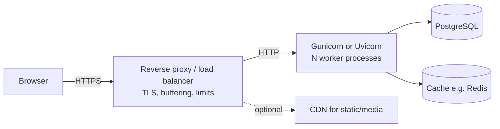

# 03 · Deploying Django: Gunicorn, Uvicorn, Static Files & PostgreSQL

`runserver` told you on day one not to use it in production. This lesson builds what you
use instead: an application server running several worker processes, static files served
efficiently, PostgreSQL, a release procedure, and a reverse proxy in front. We ran the
whole stack locally (Gunicorn 26.2.0, WhiteNoise 6.12.0, PostgreSQL 16.2) using the
environment-driven settings from lesson 02, and show what came back. What we couldn't do
from a laptop, such as obtaining a TLS certificate or configuring a specific hosting
platform, is described without invented output.

## The shape of a deployment



Platforms (PaaS offerings, container services, a VM you manage) differ in who runs which
box, but the boxes are the same.

## The application server

```bash
python -m pip install gunicorn
gunicorn config.wsgi:application --workers 3 --bind 127.0.0.1:8767 --access-logfile -
```

Our run started a master process and three workers:

```text
[INFO] Starting gunicorn 26.2.0
[INFO] Listening at: http://127.0.0.1:8767 (20128)
[INFO] Using worker: sync
[INFO] Booting worker with pid: 20131
[INFO] Booting worker with pid: 20132
[INFO] Booting worker with pid: 20133
```

Each worker is a separate process with its own copy of the app, handling one request at a
time with the default `sync` worker. The master restarts workers that crash or hang past
`--timeout` (30 seconds by default). Sizing:

- Start with roughly **2 × CPU cores + 1** sync workers (Gunicorn's own rule of thumb),
  then measure. Memory is often the real limit: each worker holds the whole app.
- For I/O-heavy apps, `--threads 4` (the `gthread` worker) lets each process overlap
  requests waiting on the database or network.
- Set `--max-requests 1000 --max-requests-jitter 100` to recycle workers periodically,
  which contains slow memory leaks.

For async views, streaming or WebSockets, serve the ASGI app instead (Level 3 · 09):
`uvicorn config.asgi:application --workers 4`, or Gunicorn managing Uvicorn workers.

## Static files with WhiteNoise

In production, something must serve `/static/`. The simplest robust option is
**WhiteNoise**, which serves `STATIC_ROOT` from the Django process with correct caching
and compression:

```python title="config/settings.py"
MIDDLEWARE = [
    "django.middleware.security.SecurityMiddleware",
    "whitenoise.middleware.WhiteNoiseMiddleware",    # directly after SecurityMiddleware
    # ...
]
STATIC_ROOT = BASE_DIR / "staticfiles"
STORAGES = {
    "default": {"BACKEND": "django.core.files.storage.FileSystemStorage"},
    "staticfiles": {"BACKEND": "whitenoise.storage.CompressedManifestStaticFilesStorage"},
}
```

`collectstatic` with this storage reported:

```text
131 static files copied to '.../staticfiles', 393 post-processed.
```

and for our stylesheet produced `site.css`, `site.a09f92d6760c.css` and gzip versions of
both. (Brotli versions are generated too if the `brotli` package is installed; we didn't
install it.) Requesting the hashed file through Gunicorn:

```text
HTTP/1.1 200 OK
Cache-Control: max-age=315360000, public, immutable
Vary: Accept-Encoding
Content-Length: 258
Content-Encoding: gzip
```

Ten years, `immutable`: safe because the hash in the filename changes whenever the
content does. Pre-compressed, so no CPU spent per request. If you put a CDN in front, it
caches these forever too. WhiteNoise doesn't serve **media** (user uploads); use object
storage for those (Level 1 · 09).

## What the app returned

The home page through Gunicorn, with `DEBUG` off:

```text
HTTP/1.1 200 OK
Server: gunicorn
Content-Type: text/html; charset=utf-8
X-Frame-Options: DENY
X-Content-Type-Options: nosniff
Referrer-Policy: same-origin
Cross-Origin-Opener-Policy: same-origin
```

A request for `/nope/` returned **404** (a plain page, not the debug page), and a
request with `Host: evil.example` returned **400**: `ALLOWED_HOSTS` rejecting a host
header it doesn't know, which defends against host-header attacks such as poisoned
password-reset links. There was no `Strict-Transport-Security` header, correctly:
`SecurityMiddleware` only sends HSTS on HTTPS requests, and our local test was plain HTTP.

## The release procedure

Every deploy runs the same steps, in this order:

```bash
python -m pip install -r requirements.txt        # pinned versions
python manage.py check --deploy --fail-level WARNING
python manage.py collectstatic --noinput
python manage.py migrate --noinput
# then start or gracefully reload the app servers
```

- **Migrations run once per release**, from one place (a release phase, a one-off job, a
  CI step), never from every web process at startup, where several would race.
- **Migrations must be compatible with the code that's still running** during a rolling
  restart: expand/contract from Level 3 · 06.
- **Graceful reload**: Gunicorn reloads on `SIGHUP`, starting new workers before
  stopping old ones, so in-flight requests finish.
- **Pin dependencies** (`pip freeze`, or a lock file from your tool of choice) so a
  release builds the same environment every time.

## The reverse proxy

In front of Gunicorn sits Nginx, Caddy, a cloud load balancer or the platform's router.
Its jobs:

- **Terminate TLS** (HTTPS certificates; Caddy and most platforms automate them).
- **Buffer slow clients**, so a phone on a bad connection uploading slowly doesn't tie up a
  sync worker for a minute.
- **Enforce limits**: request body size, timeouts, basic rate limits.
- **Pass the original scheme and client IP** (`X-Forwarded-Proto`, `X-Forwarded-For`),
  which Django uses via `SECURE_PROXY_SSL_HEADER` (lesson 02) and DRF throttling uses for
  client IPs (Level 3 · 03).

A minimal Nginx server block for the setup above:

```nginx
server {
    listen 443 ssl;
    server_name reading.example;
    # ssl_certificate / ssl_certificate_key: provided by your certificate tooling

    client_max_body_size 10m;

    location / {
        proxy_pass http://127.0.0.1:8767;
        proxy_set_header Host $host;
        proxy_set_header X-Forwarded-Proto $scheme;
        proxy_set_header X-Forwarded-For $proxy_add_x_forwarded_for;
    }
}
```

We didn't run Nginx or obtain a certificate for this lesson; treat this as a starting
point and follow your platform's documentation for TLS.

## Process management and containers

Something must start Gunicorn on boot and restart it if it dies: systemd on a VM, the
container runtime, or the platform. In a container, the usual pattern is one process type
per container (web, worker, scheduled jobs) built from one image, configured entirely by
environment variables, which is exactly what lesson 02 set up. For containers in depth see
the [Docker Mastery Path](https://sigilipelli.github.io/docker-mastery-path/); for
orchestrating them, the
[Kubernetes Mastery Path](https://sigilipelli.github.io/kubernetes-mastery-path/).

## How It Actually Works

Gunicorn's master process binds the socket, then **forks** workers that inherit it; the
operating system distributes incoming connections among the workers blocked on
`accept()`. Each worker imports `config.wsgi`, which calls `get_wsgi_application()`:
that runs `django.setup()` (settings, app registry) once per worker and returns the
`WSGIHandler` that Gunicorn calls for each request. Because state lives in separate
processes, anything kept in module globals or `LocMemCache` is per-worker, which is why
production needs shared stores (database, Redis) for anything shared.

WhiteNoise, at startup, scans `STATIC_ROOT` and builds an in-memory map from URL path to
file, noting compressed variants. Its middleware checks each request's path against that
map before Django's URL routing; on a hit it streams the file (choosing `.gz` or `.br` per
`Accept-Encoding`) with headers computed once at startup, and recognises hashed names to
add the long `immutable` cache lifetime.

## Common mistakes

- **Running `runserver` or `DEBUG=True` in production.**
- **Running `migrate` in every container's start command**, racing each other.
- **Forgetting `collectstatic`**, or using the manifest storage and getting 500s from a
  missing file (Level 1 · 09).
- **Too many workers for the database's connection limit** with `CONN_MAX_AGE`.
- **No reverse proxy in front of sync workers**, letting slow clients exhaust them.
- **Serving user uploads from the app's own domain** with WhiteNoise or Nginx without
  thinking about content types.

## Exercise

1. Install Gunicorn and WhiteNoise in your project, run `collectstatic`, and serve it with
   `DEBUG` off on a local port. Inspect a static file's headers with `curl -D -`.
2. Send a request with a `Host` header not in `ALLOWED_HOSTS`. What status do you get, and
   what does Django log?
3. Write the release steps as a script (`release.sh`) that stops at the first failure.
4. Try `--threads 4` and compare memory use (`ps`) with `--workers 4`.
5. Sketch your deployment as the diagram above for a platform you have access to,
   labelling which component provides each box.
